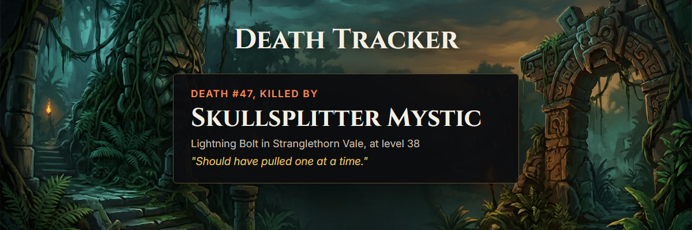

# Death Tracker

Counts your deaths and shows what killed you. For WoW: Forever.

- See what killed you on a death card, with a joke to match.
- Keep your death count on screen.
- Look back at every death on every character: killers, zones and records.
- Earn trophies, hunt your nemesis and get a recap each month.
- Share deaths with friends and see who dies most.
- Post each death to Twitch chat through Streamer.bot.

## Install

Install it from [CurseForge](https://www.curseforge.com/wow/addons/death-tracker-forever).

## Use

Click the minimap button or type `/deaths`. For Twitch chat, turn on **Send each death to
Streamer.bot** in the settings and import the code from **Show import code** in Streamer.bot.

## Report a bug

[Open a bug report](https://github.com/ImCheesecake/DeathTracker/issues/new/choose).

## License

MIT, see `LICENSE`. The libraries in `Libs/` keep their own licenses, listed in `Libs/README.md`.
